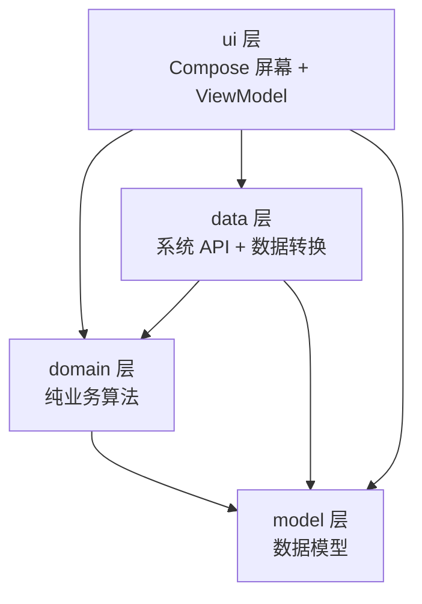

# WiFi Analyzer（WiFi 分析器）

一个现代的 Android WiFi 分析工具，基于 **Kotlin + Jetpack Compose + MVVM** 构建。它不仅扫描周围的 WiFi 热点，还提供真实的**频谱分析、信道干扰评估、最佳信道推荐**，以及深度的 **802.11 Beacon 帧解析**能力。

> 目标：做一款接近 `inSSIDer` / `NetSpot` 专业体验、但完全本地运行、无广告、无后台驻留的开源工具。

---

## ✨ 功能特性

### 扫描与列表
- 协程化的 WiFi 扫描（回调广播封装为挂起函数，支持超时与取消）
- 聚合视图 / 平铺视图一键切换（按 SSID 分组，隐藏网络按 BSSID 单独成组）
- 频段筛选（2.4G / 5G / 6G）
- 信号强度着色（强 / 中 / 弱）
- **开放网络（无加密）安全标识**，隐藏网络识别

### AP 详情
- 基础信息、信号 / 信道、能力描述、BSS Load
- **深度 Beacon IE 解析**（见下方清单）
- 信号历史趋势图（最近 N 次扫描的 RSSI 折线）

### 信道分析
- **加权信道评分**：AP 数量、平均 RSSI、BSS Load 三维护评估（0~100 分）
- **相邻信道干扰模型**：2.4GHz 按重叠系数（1.0 / 0.75 / 0.5 / 0.25）扩散，真实反映频谱占用
- **最佳信道推荐**：从非重叠 / 非 DFS 候选信道中选出干扰最小者

### 频谱图
- 真实**连续频率域**绘制（非离散信道条形图）
- 升余弦频谱掩码（带宽内平坦、边缘滚降），贴近 OFDM 真实频谱
- 按 `centerFreq0` + 信道带宽确定能量分布，80+80 拆为两段
- 点击 AP 图例可高亮单个 AP 的频谱，重叠区域自然叠加

### 其他
- 设置页：自动扫描、持续扫描（前台每 5s 刷新，退出即停）、默认视图模式、导出报告
- 运行时语言切换（跟随系统 / 中文 / English）
- 一键导出 / 分享扫描报告

---

## 📡 Beacon IE 解析清单

| 信息元素（IE） | 解析内容 |
|---|---|
| RSN / RSNXE | 加密套件、AKM（PSK / SAE / OWE / 802.1X…）、MFP、Beacon Protection |
| HT（802.11n） | LDPC、SGI、Greenfield、40MHz、A-MPDU / A-MSDU、STBC |
| VHT（802.11ac） | 信道宽度、MCS、LDPC、SGI、Beamforming |
| HE（802.11ax） | TWT、MU EDCA、OM Control、Beamforming、160MHz |
| EHT（802.11be） | 320MHz、4096-QAM、TXOP Sharing、Puncturing |
| Country | 国家码、环境、信道 / 功率三元组 |
| BSS Load | 关联站点数、信道利用率、剩余容量 |
| Extended Capabilities | TWT、OCV、BSS Transition 等能力位 |
| Transmit Power Envelope | 最大发射功率、本地 / 客户端功率 |
| Mobility Domain（802.11r） | MDID、快速漫游能力 |
| RNR（Reduced Neighbor Report） | 邻居 AP 的 BSSID、信道、Short-SSID（6GHz 发现关键） |
| Multiple BSSID | Max BSSID Indicator、Profile 列表 |
| Vendor Specific | 厂商 OUI 与原始数据 |

所有原始字节仍保留在「Raw Information Elements」折叠区，供需要时查看。

---

## 🏗️ 架构设计

采用 **MVVM + 单向数据流（StateFlow）**，四层结构，依赖单向向下：

```
ui → domain → model
ui → data → domain / model
```



| 层 | 职责 | 关键类 |
|---|---|---|
| `ui/` | Compose 界面、ViewModel、导航、状态管理 | `WifiViewModel`、`WifiApp` |
| `domain/` | 纯 Kotlin 业务逻辑，**零 Android 依赖**，可单测 | `ChannelCalculator`、`ChannelAnalyzer`、`ChannelScorer`、`ChannelRecommender`、`SpectrumAnalyzer`、`ReportGenerator` |
| `data/` | 系统 API 交互、数据转换，Android 依赖隔离在此 | `WifiScanner`、`ScanResultMapper`、`BeaconIeDecoder` |
| `model/` | 纯数据模型，零依赖 | `WifiData`、`BeaconInfo`、`ChannelWidth` |

### 关键设计点
- **依赖倒置**：`WifiRepository` / `SettingsRepository` 接口抽象，ViewModel 不直接接触系统 API，便于测试与替换。
- **framework-free domain**：domain 层不 import 任何 Android SDK 类（`ChannelWidth` 枚举替代了 `ScanResult.CHANNEL_WIDTH_*`）。
- **加权频谱模型**：信道评分与频谱图都基于真实中心频率 + 带宽，而非简单按主信道归类。

---

## 🛠️ 技术栈

| 类别 | 技术 |
|---|---|
| 语言 | Kotlin 2.2.10 |
| UI | Jetpack Compose（Material 3，BOM 2026.02） |
| 架构 | MVVM + StateFlow 单向数据流 |
| 导航 | Navigation Compose |
| 异步 | Kotlin 协程（`viewModelScope`、`suspendCancellableCoroutine`） |
| 构建 | Gradle 9.6 + AGP 9.5.1 |
| 图表 | 自绘 Compose Canvas（无第三方图表库） |
| 持久化 | SharedPreferences（设置项） |
| 测试 | JUnit 4（纯 JVM 单元测试） |
| minSdk / targetSdk | 30 / 37 |

---

## 📦 构建

### 环境要求
- **JDK 17**（Gradle 9.6 要求）
- Android SDK（`compileSdk 37`）

### 命令

```bash
# 调试版
./gradlew assembleDebug

# Release 版（需签名，见下文）
./gradlew assembleRelease

# 运行单元测试
./gradlew testDebugUnitTest
```

---

## 🔐 签名

Release 构建使用**可选签名**，签名信息优先级：**环境变量（CI）> 本地 `keystore.properties` > 跳过签名**。

### 本地签名（可选）
在项目根目录创建 `keystore.properties`（已被 `.gitignore` 忽略）：

```properties
storeFile=release.keystore
storePassword=你的keystore密码
keyAlias=你的别名
keyPassword=你的key密码
```

> `storeFile` 为相对项目根目录的路径。Keystore 文件同样已被 `.gitignore` 忽略，**切勿提交到 Git**。

### CI 签名（GitHub Actions）
在仓库配置 4 个 Secrets：
- `KEYSTORE_BASE64`：keystore 文件的 base64 编码
- `KEYSTORE_PASSWORD`
- `KEY_ALIAS`
- `KEY_PASSWORD`

---

## 🤖 CI / CD

GitHub Actions 自动构建（[`.github/workflows/build-release.yml`](.github/workflows/build-release.yml)）：

- **push 到 `master`** → 跑测试 + 构建 Release APK，上传到 Artifacts
- **打 tag `v*`** → 额外自动创建 GitHub Release 并附带 APK
- **手动触发**（workflow_dispatch）

---

## 🧪 测试

85 个 JVM 单元测试，覆盖：

- **信道算法**：`ChannelCalculator`（频率 / 信道 / 占用）、`ChannelScorer`（评分）、`ChannelAnalyzer`（聚合）、`ChannelRecommender`（推荐）
- **频谱分析**：`SpectrumAnalyzer`（升余弦掩码、带宽、80+80）
- **Beacon 解析**：`BeaconIeDecoder`（RSN / RSNXE / Country / BSS Load / Power Envelope / Mobility Domain / RNR / Multiple BSSID）
- **报告生成**：`ReportGenerator`
- **模型逻辑**：`WifiData.groupKey`

```bash
./gradlew testDebugUnitTest
```

---

## 📁 项目结构

```
WiFiAnalyzer/
├── app/
│   ├── src/
│   │   ├── main/
│   │   │   ├── java/top/pingwcy/wifianalyzer/
│   │   │   │   ├── MainActivity.kt          # 入口 Activity
│   │   │   │   ├── data/                    # 数据层
│   │   │   │   │   ├── WifiScanner.kt       # 系统扫描封装
│   │   │   │   │   ├── ScanResultMapper.kt  # ScanResult → WifiData
│   │   │   │   │   ├── BeaconIeParser.kt    # Android 适配层
│   │   │   │   │   ├── BeaconIeDecoder.kt   # 纯 Kotlin IE 解码器
│   │   │   │   │   └── SettingsRepositoryImpl.kt
│   │   │   │   ├── domain/                  # 领域层（纯 Kotlin）
│   │   │   │   │   ├── ChannelCalculator.kt
│   │   │   │   │   ├── ChannelAnalyzer.kt
│   │   │   │   │   ├── ChannelScorer.kt
│   │   │   │   │   ├── ChannelRecommender.kt
│   │   │   │   │   ├── SpectrumAnalyzer.kt
│   │   │   │   │   └── ReportGenerator.kt
│   │   │   │   ├── model/                   # 模型层（零依赖）
│   │   │   │   └── ui/                      # UI 层
│   │   │   │       ├── WifiViewModel.kt
│   │   │   │       ├── WifiApp.kt           # 导航
│   │   │   │       ├── screen/              # 各屏幕
│   │   │   │       ├── component/           # 可复用组件
│   │   │   │       └── theme/
│   │   │   └── res/                         # 资源（values / values-en）
│   │   └── test/                            # 单元测试
│   └── build.gradle.kts
├── .github/workflows/                       # CI 配置
├── gradle/
├── build.gradle.kts
├── settings.gradle.kts
└── gradle.properties
```

---

## 🔑 权限说明

| 权限 | 用途 |
|---|---|
| `ACCESS_WIFI_STATE` / `CHANGE_WIFI_STATE` | WiFi 状态与扫描 |
| `ACCESS_FINE_LOCATION` / `ACCESS_COARSE_LOCATION` | 旧版本 Android 的 WiFi 扫描（可推断位置） |
| `NEARBY_WIFI_DEVICES`（Android 13+） | 附近设备扫描权限 |
| `ACCESS_NETWORK_STATE` | 网络状态判断 |

应用**不申请**后台定位、不驻留后台、不需要 root。

---

## 📄 License

暂未指定开源协议。
